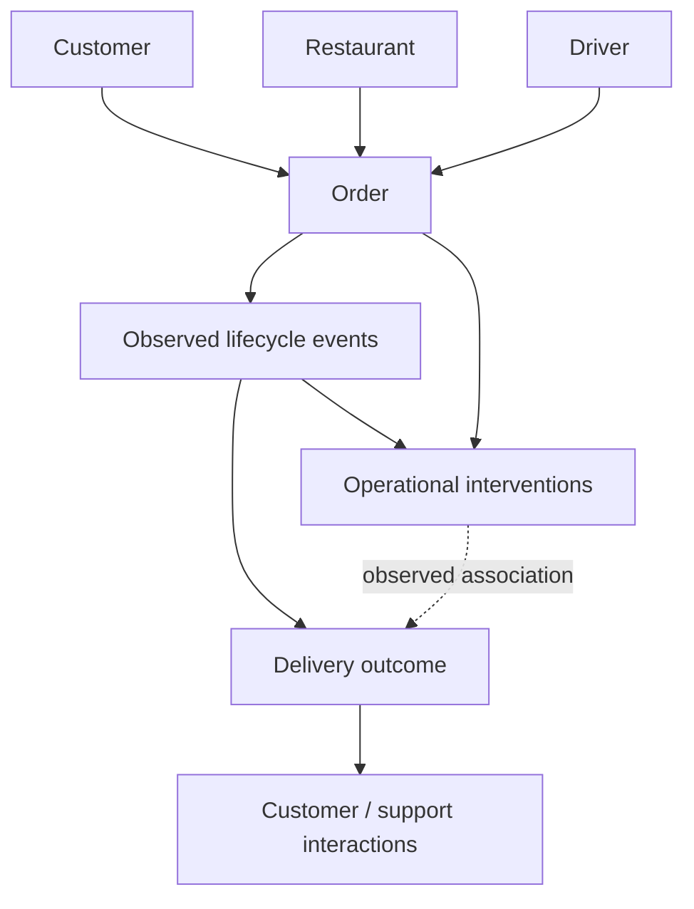

# Workflow model

`canonical_orders.csv` contains one row per order. Interventions are deduplicated to one order/type pair before outcome comparison; outcomes are joined many-to-one. Customer actions, support interactions, interventions and lifecycle events retain their own grains in separate files.

| Type | Examples |
|---|---|
| Observed | Order creation, pickup, delivery, assignment, GPS ping, customer action, support interaction, intervention |
| Derived | Stage elapsed minutes, delay, late flag/rate, interaction/intervention rates |
| Inferred | Restaurant arrival from GPS proximity; no explicit reliable arrival event exists |

The stage intervals measure order-to-pickup and pickup-to-delivery elapsed time. Pickup-to-delivery is not restaurant waiting time: without a reliable driver-arrival timestamp, restaurant waiting cannot be directly measured. Intervention comparisons are observational and do not establish causal effects.
